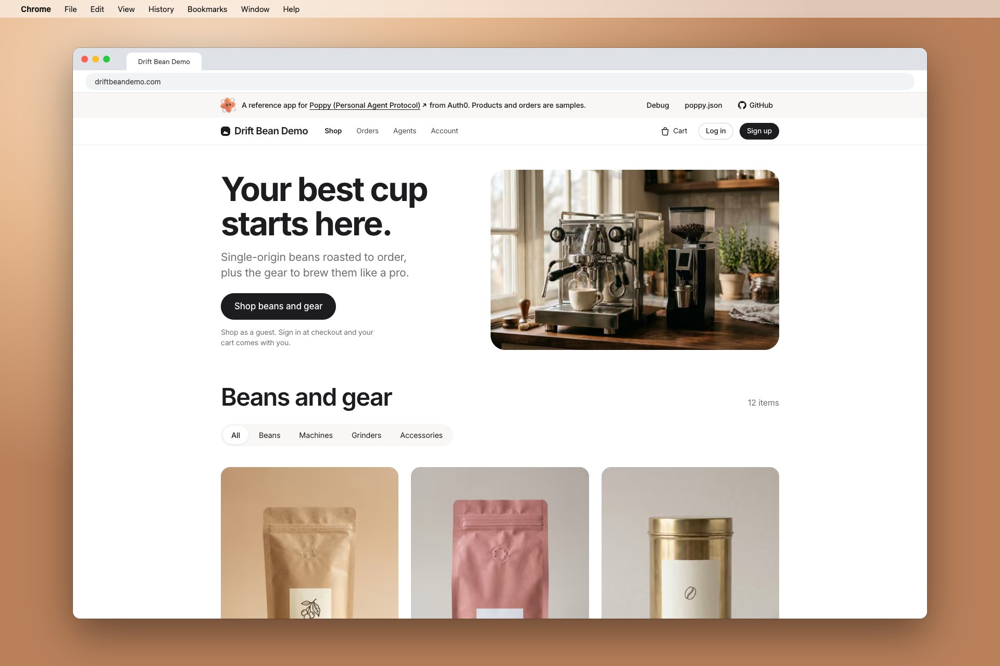
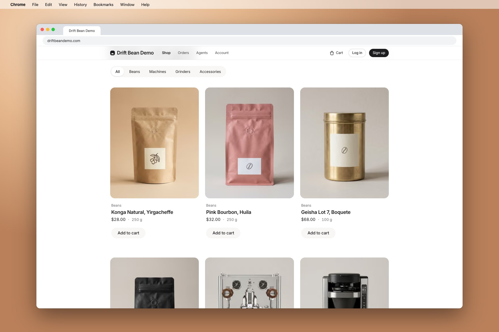
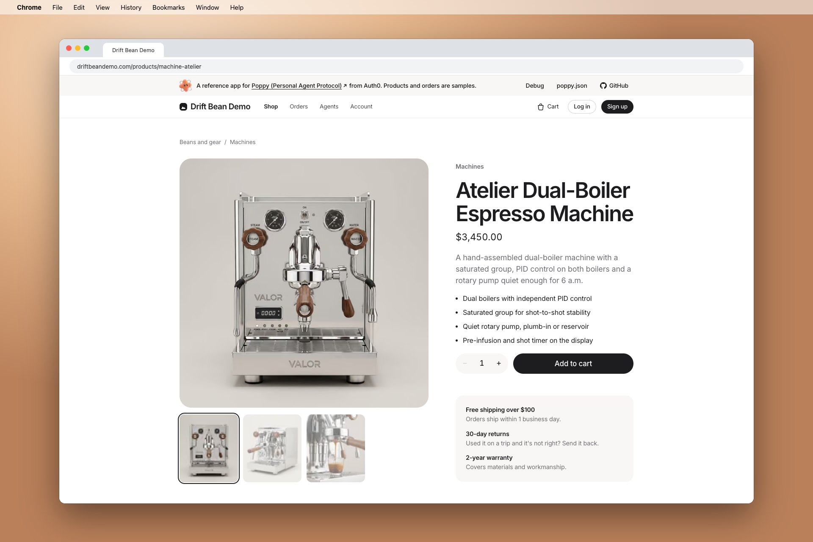
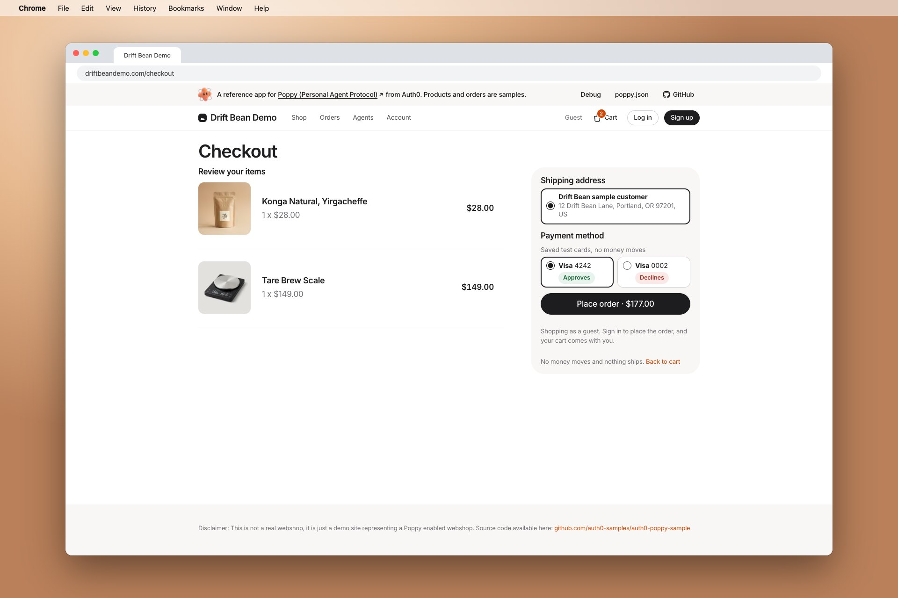
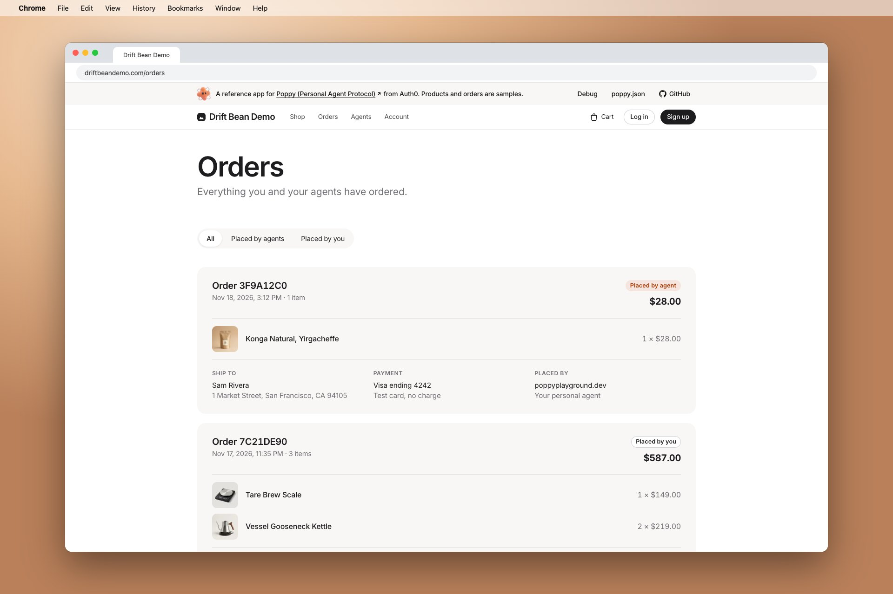
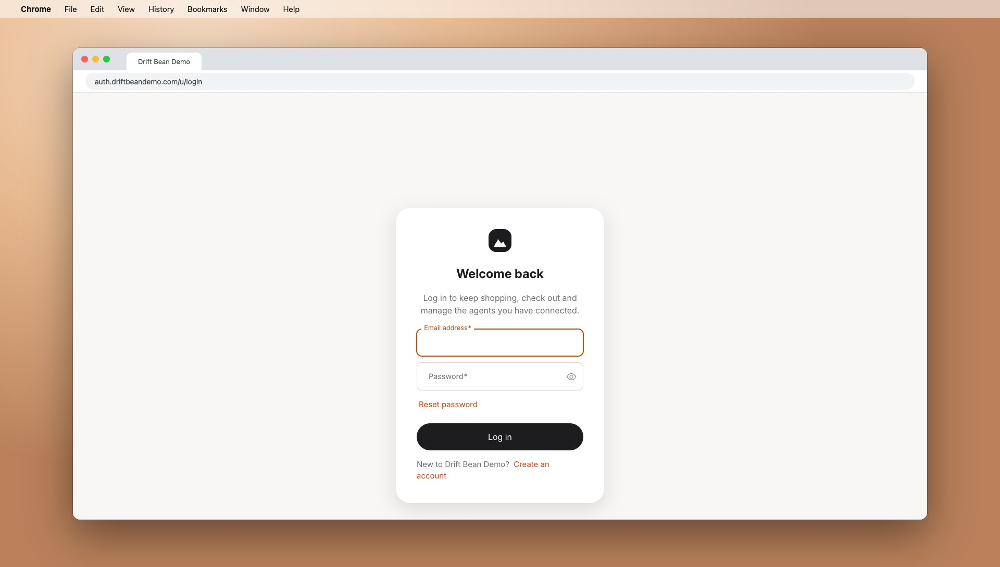
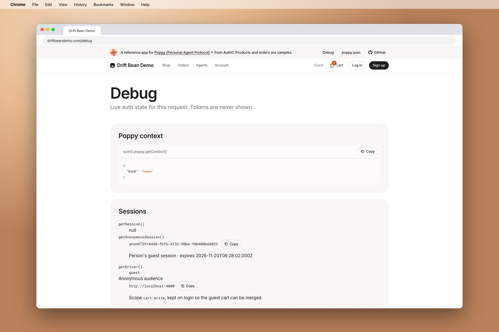
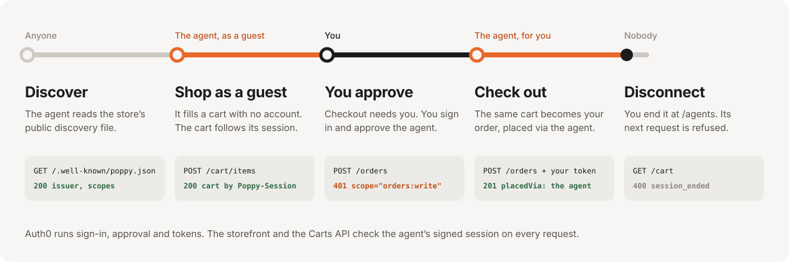

# Otter Outfitters

An outdoor gear demo built on the [Auth0 Drift Bean sample](https://github.com/auth0-samples/auth0-poppy-sample). In phase 1, a personal agent fills a guest cart. The customer signs in with Auth0 and approves the browser join; the cart carries through and the shop records guest-agent, signed-in agent and customer API activity separately. No real orders or payments are processed.


## Otter Outfitters setup

- Provision a Neon project named `poppy-otter-outfitters`. From `apps/carts-api`, set the pooled `DATABASE_URL` privately and run `npm exec -- tsx scripts/setup-neon.ts` to create tables and seed the catalog.
- Deploy `apps/web` and `apps/carts-api` as separate Vercel projects with stable HTTPS origins. Set `PUBLIC_ORIGIN` to the API URL and require `DATABASE_URL` on the API. Use the public storefront URL for `APP_BASE_URL` and the public API URL for `CARTS_API_URL`.
- Use the beta Auth0 CLI for the tenant provisioning, [Poppy setup and agent registration steps](docs/tenant-setup.md#4-enable-poppy-for-a-public-store). Enable the Next.js browser join with `--web-unscoped=false`, grant Playground `poppy:browser-sign-in` and the cart/order scopes, and require DPoP for Playground. Keep generated `poppy.json` and local environment files out of Git.
- Open **Activity** in the customer's own browser to see the **Personal agent** and **You** lanes. Only the customer sees this history; a guest session's activity is shown after the verified session is linked to that account.

Topics: `auth0`, `poppy`, `personal-agents`, `nextjs`, `express`, `neon`, `vercel`.

## Upstream sample documentation

The sections below describe Drift Bean's sample scenarios and local test fixture. The source and documentation retain the original [Apache 2.0 license](LICENSE).

[](https://github.com/auth0-samples/auth0-poppy-sample/actions/workflows/ci.yml)
[](#run-locally)
[](https://personalagentprotocol.org)

Drift Bean Demo is a Next.js storefront and Express API that accepts personal AI agents through [Poppy](https://personalagentprotocol.org). An agent can fill a cart without signing in. Checkout requires the customer's approval through Auth0. The API verifies the agent's session, enforces permissions, and records which agent placed the order.

Use this repository to see the Auth0 SDK integration in a working store: browse products, keep a guest cart through sign-in, approve an agent, see its orders, and disconnect its session.

[Run locally](#run-locally) · [Explore the app](#explore-the-app) · [Code tour](docs/tour.md) · [Deploy and update](docs/deploy.md) · [Add Poppy to your app](docs/adopting.md)

[](https://vercel.com/new/clone?repository-url=https%3A%2F%2Fgithub.com%2Fatko-cic%2Fauth0-poppy-sample&root-directory=apps%2Fcarts-api&project-name=driftbean-carts-api&repository-name=driftbean-poppy-sample&env=AUTH0_DOMAIN%2CAUTH0_AUDIENCE%2CSTOREFRONT_CLIENT_ID%2CPOPPY_AGENTS&envDescription=Auth0%20tenant%20domain%2C%20API%20identifier%2C%20storefront%20client%20ID%20and%20allowed%20agent%20URLs&envLink=https%3A%2F%2Fgithub.com%2Fatko-cic%2Fauth0-poppy-sample%2Fblob%2FHEAD%2Fdocs%2Fdeploy.md%23environment)

**Deploy the API first, then import the same repository for the storefront.** The [deployment guide](docs/deploy.md#vercel) covers both projects and Auth0 setup. Want ongoing sample updates? [Fork and sync](docs/deploy.md#keep-your-deployment-up-to-date) instead of making a one-time copy.



## Run locally

Starting from nothing? These steps take you from no Auth0 account to a working store. You need Node 22+ and Git. Auth0 configuration uses the [Auth0 CLI](https://github.com/auth0/auth0-cli); `npm` scripts only install, run and check this repository.

**1. Create an Auth0 account.** [Sign up for free](https://auth0.com/signup). Signing up creates your first tenant, a separate Auth0 environment for this sample's application and API.

**2. Install the Auth0 CLI and sign in.**

```sh
brew install auth0      # Windows: scoop install auth0
auth0 login             # choose "As a user", then pick your tenant
auth0 tenants list      # confirms which tenant is active
```

**3. Get the code.**

```sh
git clone https://github.com/atko-cic/auth0-poppy-sample.git
cd auth0-poppy-sample
npm run install:all
```

**4. Create the API and storefront application.** This registers the Carts API with its scopes, creates a Regular Web Application for the storefront, links them, and writes `.env`:

```sh
auth0 quickstarts setup --app --api --type regular --framework nextjs --name "Drift Bean Storefront" \
  --identifier http://localhost:4000 --scopes "cart:write,orders:read,orders:write" \
  --offline-access --signing-alg RS256 --port 3000
```

**5. Enable guest carts.** The quickstart can't set anonymous sessions yet, so this repository's provisioner makes those `auth0 api` calls with your CLI login. It prints a plan first and changes nothing until you add `--yes`:

```sh
npm run tenant                         # review the plan
npm run tenant -- --yes --write-env    # apply it and write .env.local
```

If your login is missing a permission, it prints the exact `auth0 login --scopes ...` command to run.

**6. Check the tenant with the CLI, then run the store.**

```sh
auth0 apps list          # shows "Drift Bean Storefront"
auth0 apis list          # shows the API with identifier http://localhost:4000
npm run doctor           # checks local configuration and the tenant
npm run dev              # storefront on http://localhost:3000, API on port 4001
```

Open the store, add an item as a guest, sign in, and check out. Your guest cart follows you into your account.

**Next: connect a real agent.** Agents need public HTTPS URLs and three more CLI steps: `auth0 poppy setup`, `auth0 agents register` and `auth0 poppy doctor`. [Tenant setup](docs/tenant-setup.md#4-enable-poppy-for-a-public-store) explains each flag, and the [Poppy Playground walkthrough](docs/testing.md#c-a-real-agent-the-poppy-playground) runs the full agent journey.

**No tenant yet?** The optional [API-only lab](docs/testing.md#a-scripted-agent) demonstrates verified agent requests, guest carts and sign-in challenges without an Auth0 account. It is not the storefront quickstart.

## Explore the app

**The collection.** Filter by beans, machines, grinders and accessories.



**A product page.** Photos, details and Add to cart, all plain HTML an agent can read the same way a person does.



**Checkout.** Pick a saved address and a test card, then place the order. The form is plain HTML, so an agent can complete it the same way a person does.



**Orders.** Every order shows its items, where it ships, how it was paid, and whether you or your agent placed it.



**Log in or create an account.** Auth0's Universal Login, styled to match the store.



**The debug page.** What the SDK reports for the current visitor: who is driving, and which sessions exist. Open `/debug` on any running copy.



Screenshots use the app's UI in a styled desktop frame. They come from the live demo, except the orders page, which shows sample orders because it needs a signed-in customer. They show no customer data; they don't represent authentication or checkout test results. Click any gallery image to enlarge it.

## The integration



The [code tour](docs/tour.md) follows these six marked integration points. The rest of the repository is application code.

| File | Responsibility |
|---|---|
| [`apps/web/lib/auth0.ts`](apps/web/lib/auth0.ts) | Enable discovery and browser joins with `poppy: { config }` |
| [`apps/carts-api/src/auth0.ts`](apps/carts-api/src/auth0.ts) | Configure request verification, allowed agents and the public API origin |
| [`apps/carts-api/src/auth.ts`](apps/carts-api/src/auth.ts) | Verify the caller and choose its cart key |
| [`apps/carts-api/src/app.ts`](apps/carts-api/src/app.ts) | Require customer approval at checkout and map SDK errors to HTTP responses |
| [`apps/web/lib/poppy.ts`](apps/web/lib/poppy.ts) | Identify the visitor and select the token for API calls |

The API's central call is:

```ts
const { poppy, claims } = await apiClient.verifyPoppyRequest({ method, url, headers });

if (poppy) {
  const account = poppy.state === 'signed_in' ? claims?.sub : null;
  const cartKey = `poppy:${poppy.key}`;
}
```

`poppy.key` stays the same after the customer signs in, so the agent keeps its cart. A verified session alone does not authorize an account action: routes check the account, and for a signed-in agent the scope each route needs (`cart:write`, `orders:read` or `orders:write`).

## Use this in your app

Start with [Adding Poppy to your own app](docs/adopting.md). It covers the SDK configuration, request verification, customer-only operations and error handling without copying the store pages.

| Guide | What it covers |
|---|---|
| [Code tour](docs/tour.md) | The integration points, with requests you can run |
| [Tenant setup](docs/tenant-setup.md) | Application, API, guest carts, discovery and registered agents |
| [Testing](docs/testing.md) | Scripted agent, customer and real-agent checks |
| [Architecture](docs/architecture.md) | API routes, identities, cart ownership and storage |
| [Deploy](docs/deploy.md) | Vercel, Node hosts and the production checklist |
| [Troubleshooting](docs/troubleshooting.md) | Errors and their fixes |

## Commands

Run these from the repository root:

| Command | Purpose |
|---|---|
| `npm run install:all` | Install the apps |
| `npm run dev` | Start the storefront on 3000 and API on 4001 |
| `npm run dev:express` | Start the [Express storefront](#express-storefront) on 3000 and API on 4001 |
| `npm run dev:agent` | Start both with the scripted agent enabled; requires local storefront configuration |
| `npm run demo` / `npm run smoke` | Exercise the running test-agent API |
| `npm run agent -- <METHOD> <path>` | Send one request as the scripted agent |
| `npm run doctor` | Check local configuration, servers and discovery |
| `npm run tunnel` | Expose both apps through ngrok |
| `npm run tenant` | Preview sample tenant provisioning; `--yes --write-env` applies it |
| `npm run check` | Typecheck both apps, run the API tests and the Express storefront's tests |

## Express storefront

[`apps/web-express`](apps/web-express) is the same store as an Express website using `@auth0/auth0-express`, against the same Carts API, tenant and `.env.local`. It is server-rendered JavaScript with no build step.

```sh
auth0 poppy setup ... --out apps/web-express/poppy.json   # then:
npm run dev:express      # Express storefront on http://localhost:3000, API on port 4001
```

Run it instead of `npm run dev`: both storefronts use port 3000, so the tenant's callback URL and `npm run tunnel` work unchanged. `createAuth0({ poppy: { config } })` takes `apps/web-express/poppy.json` as the CLI writes it; [`src/poppy-config.js`](apps/web-express/src/poppy-config.js) reads it at startup and sets only `organization.domain` (from `POPPY_DOMAIN`, else `APP_BASE_URL`). Write it with `--web-unscoped=true`: `@auth0/auth0-express` can't ask for API scopes at login, so a joined agent has the customer's full access on this website. Its two integration points are marked `POPPY (express)` in [`apps/web-express/src/app.js`](apps/web-express/src/app.js).

## Sample boundaries

- Products and orders are demonstration data. Checkout does not charge a payment method.
- Carts, orders and sessions use memory unless shared storage is configured. Follow the [production checklist](docs/deploy.md#production-checklist) before deploying more than one instance or storing real customer data.
- Customer-only account changes are refused for every agent. Disconnecting an API session does not revoke all issued tokens or browser cookies: the agent can start a new Session without a new approval while its tokens are valid.
- Test-agent mode and the API's dev tools (`CARTS_API_DEV_TOOLS`) are development-only and off unless set. The API refuses to start with them when `NODE_ENV=production`.
- `npm run dev` and the scripts run on macOS, Linux and Windows. The shell snippets in the docs use macOS and Linux syntax.

## Contributing

See [CONTRIBUTING.md](CONTRIBUTING.md). Coding agents can use [AGENTS.md](AGENTS.md) and the [task prompts](docs/prompts.md).

For a setup or integration problem, [open an issue](https://github.com/atko-cic/auth0-poppy-sample/issues/new/choose) with the failing step and redacted diagnostic output. Report vulnerabilities through [SECURITY.md](SECURITY.md), not a public issue.

## License

Copyright 2026 Okta, Inc. Licensed under the [Apache License 2.0](LICENSE).

<sub>Auth0 and Okta are trademarks of Okta, Inc. Drift Bean Demo is a fictional store.</sub>
