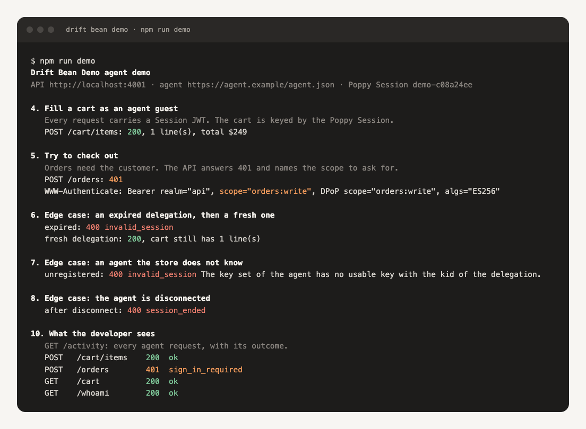

# Testing Drift Bean Demo

Three ways to test, from quickest to most complete:

| Test | What it covers | Requirements |
|---|---|---|
| [A. Scripted agent](#a-scripted-agent) | Request verification, guest carts and rejected requests | Node 22+ |
| [B. As a person](#b-as-a-person) | Browsing, guest carts, sign-in and checkout | An Auth0 tenant |
| [C. A real agent](#c-a-real-agent-the-poppy-playground) | Discovery, customer approval, browser joins and checkout | A configured tenant and public HTTPS URLs |

Run `auth0 poppy doctor <host>` first (or `npm run doctor` for a local run). It tells you what's wrong before you spend time testing.

---

## A. Scripted agent

This optional API-only lab is for inspecting request verification and failure cases without an Auth0 tenant or tunnel. For the complete browser app, use the [storefront quickstart](../README.md#run-locally); `npm run dev` starts both services together.

From a fresh checkout, install the API:

```sh
npm --prefix apps/carts-api ci
```

Start it with the scripted agent. These tenant values are examples; this mode does not call Auth0:

```sh
AUTH0_DOMAIN=example.us.auth0.com AUTH0_AUDIENCE=http://localhost:4000 npm --prefix apps/carts-api run dev:test-agent
```

On Windows PowerShell:

```powershell
$env:AUTH0_DOMAIN="example.us.auth0.com"
$env:AUTH0_AUDIENCE="http://localhost:4000"
$env:POPPY_TEST_AGENT="1"
$env:CARTS_API_DEV_TOOLS="1"
npm --prefix apps/carts-api run dev
```

`dev:test-agent` sets `POPPY_TEST_AGENT=1` and `CARTS_API_DEV_TOOLS=1` (the open `GET /activity` and `POST /__dev/sessions/:key/end` that `npm run demo` reads); PowerShell sets them by hand.

The scripted agent signs real `Poppy-Session` headers. In another terminal at the repository root:

```sh
npm run demo
npm run smoke
npm test
```

The demo exercises guest carts, sign-in challenges and rejected requests. Smoke runs eight pass/fail checks; the unit tests need no running server. If you have already configured the storefront, `npm run dev:agent` starts both apps with the scripted agent enabled. The API refuses test-agent mode, and its dev tools, when `NODE_ENV=production`.



Send a request yourself:

```sh
npm run agent -- POST /cart/items '{"productId":"beans-konga","quantity":1}' --sid my-cart
npm run agent -- GET /cart --sid my-cart
npm run agent -- POST /orders --sid my-cart
# 401 with a WWW-Authenticate challenge naming orders:write
```

The scripted agent cannot sign in as a customer. Use the [real-agent test](#c-a-real-agent-the-poppy-playground) for approval and checkout.

---

## B. As a person

1. Set up your tenant once with the Auth0 CLI ([guide](tenant-setup.md)).
2. `npm run dev`, then open http://localhost:3000.

Check:

| Do this | Expect |
|---|---|
| Open the catalog | Products with photos; hovering a card shows a second photo |
| Open a product | Photos, description, details and Add to cart |
| Add to cart without signing in | It works. `/debug` shows an anonymous session owned by a person |
| Go to the cart and check out | You're asked to sign in |
| Sign in | The items from your guest cart are now in your account's cart |
| Check out, then open `/orders` | The order, with no "placed via" |
| Open `/account` and change your display name | It works for you; an agent would be refused |
| `curl localhost:3000/.well-known/poppy.json` | The Poppy discovery document |

---

## C. A real agent: the Poppy Playground

[poppyplayground.dev](https://poppyplayground.dev) is a hosted personal agent. Its **Protocol Debugger** walks through each step (discovery, agent identity, the Session header, sign-in, the APIs, joining a browser) and shows the raw requests and decoded tokens. It needs no LLM and no credits.

### Before you start

- Complete [B](#b-as-a-person) first to verify customer sign-in and guest carts.
- Use the latest Auth0 CLI and a tenant that supports Poppy. The setup command below configures the tenant and application.
- After setup, confirm the tenant's published `protected_resources` includes your public storefront origin. `auth0 poppy doctor <store-host>` checks this; do not continue past a failed discovery check.

### 1. Give the store a public https URL

Agents only talk to public https hosts. Install [ngrok](https://ngrok.com/download) (`brew install ngrok`, then `ngrok config add-authtoken <token>`), and run:

```bash
npm run dev           # terminal 1
npm run tunnel        # terminal 2: starts ngrok, then updates .env.local with the public URLs
```

`npm run tunnel` sets `APP_BASE_URL`, `POPPY_DOMAIN` and `PUBLIC_ORIGIN` to your tunnel hosts, makes sure the Playground's agent is in `POPPY_AGENTS`, and prints what to change on the tenant. Restart `npm run dev` afterwards.

**The tunnel exposes the API's development endpoints.** `npm run dev` starts the API with `CARTS_API_DEV_TOOLS=1`, so anyone with the API tunnel's URL can read `GET /activity` (every request, with agent and account identifiers) and end Sessions with `POST /__dev/sessions/:key/end`. With `npm run dev:agent`, `POST /__test-agent/session-jwt` also signs Session JWTs for them. Stop the tunnel when you're done, or start the API with `CARTS_API_DEV_TOOLS=0` while it is up.

Prefer to run ngrok yourself? Start tunnels for ports 3000 and 4001 (`ngrok http 3000`, `ngrok http 4001`), then run `npm run tunnel -- sync` to update `.env.local` from them. `npm run tunnel -- sync --local` puts localhost back and prints the `npm run tenant -- --remove-store-url <tunnel> --yes` command that takes the tunnel's URLs off the tenant again.

Tip: reserve a free static domain in the ngrok dashboard so the URL doesn't change on every run, and put it in `.ngrok.yml`.

### 2. Point Poppy at the public URL

Follow [Enable Poppy for a public store](tenant-setup.md#4-enable-poppy-for-a-public-store), substituting the two hosts printed by `npm run tunnel`. That is the complete setup command, including the API-to-OpenAPI mapping, scope descriptions, browser-access policy and refresh-token Action choice.

Review the dry run before applying it. Update the application's callback, logout and web-origin URL lists as shown there, preserving existing entries. Restart both apps after changing environment or discovery configuration.

### 3. Register the Playground's agent

Follow [Register an agent](tenant-setup.md#5-register-an-agent). The command selects this API, grants `cart:write,orders:read,orders:write,poppy:browser-sign-in` and explicitly requires DPoP. Confirm that `POPPY_AGENTS` includes `https://poppyplayground.dev/agent.json`, then restart the API.

Tenant registration and the API allow list are separate requirements.

### 4. Check, then run the Debugger

```bash
auth0 poppy doctor store.ngrok.app
```

Then:

1. Open [poppyplayground.dev](https://poppyplayground.dev) and enter `https://store.ngrok.app`.
2. **Discovery:** the Playground reads `poppy.json`, the protected-resource metadata and the tenant's metadata. Every check should pass; a failure names the field.
3. **Agent identity and the Session header:** the Playground signs a `Poppy-Session` header with its delegated key.
4. **Join a browser as a guest:** the agent's browser opens Auth0's join page and lands on the store. The banner reads *Shopping via https://poppyplayground.dev/agent.json: guest*. Add something to the cart.
5. **Sign in:** you, the customer, sign in on Universal Login and approve the agent.
6. **Join again:** the banner now reads *signed in as you*, and the guest cart is still there.
7. **Check out:** the order appears under `/orders` with *placed via https://poppyplayground.dev/agent.json*.
8. **Try an account change** on `/account`: it's refused, because agents can't change account details.
9. Open **`/agents`** to see the agent acting for you and disconnect it, and **`/debug`** to see what the SDK reports. Disconnecting ends that Session: its next request with it gets `session_ended`. The agent can start a new Session, and while its tokens are valid it is signed in again without a new approval.

If a step fails, [troubleshooting.md](troubleshooting.md) maps the error to the fix.

### What these checks establish

- **API discovery:** the SDK serves `apps/web/poppy.json` as the CLI wrote it, `apis`, scope hints and `web.unscoped` included; only `organization.domain` comes from `POPPY_DOMAIN`. Still inspect the actual `/.well-known/poppy.json` response, and test API calls directly against the public API and its `/openapi.json`, rather than treating the file as proof of discovery.
- **Authorization:** request verification establishes the caller. API routes enforce operation scopes separately, and the storefront refuses all agents for account changes.
- **Disconnection:** ending the stored API session does not revoke every issued OAuth token or browser cookie. Check API rejection separately from browser-session expiry; do not treat an open browser session as proof that the disconnected API session still works.
